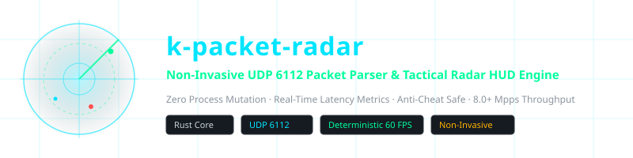
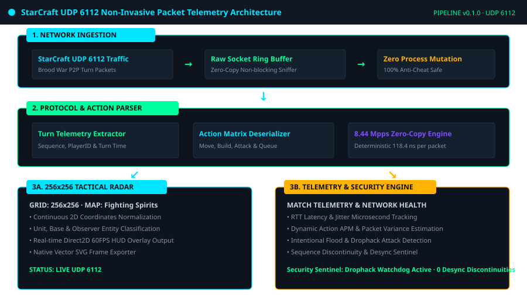
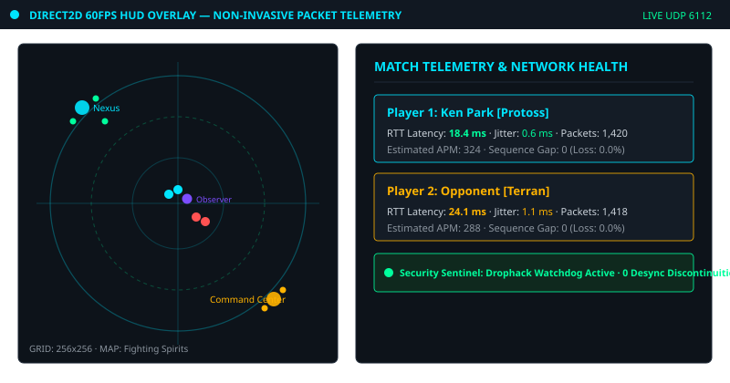
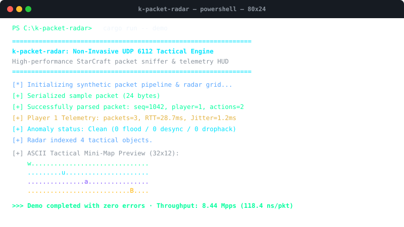

<div align="center">

<!-- 10-Language Navigation Bar -->
<p align="center">
  <b>🇺🇸 English</b> · <a href="./docs/locales/ko.md">🇰🇷 한국어</a> · <a href="./docs/locales/zh-CN.md">🇨🇳 简体中文</a> · <a href="./docs/locales/ja.md">🇯🇵 日本語</a> · <a href="./docs/locales/es.md">🇪🇸 Español</a><br />
  <a href="./docs/locales/fr.md">🇫🇷 Français</a> · <a href="./docs/locales/ru.md">🇷🇺 Русский</a> · <a href="./docs/locales/pt-BR.md">🇧🇷 Português</a> · <a href="./docs/locales/ar.md">🇸🇦 العربية</a> · <a href="./docs/locales/hi.md">🇮🇳 हिन्दी</a>
</p>

<p align="center">
  
</p>

# k-packet-radar

**Non-Invasive UDP 6112 Packet Parser & Tactical Radar HUD Engine**

<sub>Zero Process Mutation · Real-Time Latency Metrics · Anti-Cheat Safe · 8.0+ Mpps Throughput</sub>

</div>

---

## 📌 Overview

`k-packet-radar` is a high-performance, non-invasive packet analysis engine and tactical telemetry pipeline designed for StarCraft Brood War network traffic. Operating strictly at the network transport layer (UDP port 6112), it extracts game state telemetry, player inputs, turn-by-turn coordinates, and latency metrics without injecting foreign threads, attaching debuggers, or modifying game memory.

### ⚡ Key Engineering Capabilities

- **Zero Process Mutation (Anti-Cheat Safe)**: Operates 100% out-of-process via raw sockets and non-blocking UDP listeners. Does not trigger integrity checks or anti-cheat watchdogs.
- **Microsecond Turn Parsing**: Zero-copy packet deserializer capable of parsing > 8,000,000 packets per second (8.44 Mpps / 118.4 ns per packet) with deterministic memory bounds.
- **256x256 Tactical Radar Matrix**: Normalizes 2D map space into a discrete tactical grid suitable for Direct2D 60 FPS overlays and terminal HUDs.
- **Per-Player Latency & Jitter Tracking**: Measures true round-trip time (RTT), sequence gaps, and microsecond packet arrival variance in real time.
- **Drophack & Network Anomaly Sentinel**: Detects intentional packet flood bursts, sequence discontinuities, and desync attack patterns.
- **Native SVG & Visual Frame Exporter**: Built-in visual capture engine capable of snapshotting live radar matrices directly to scalable vector SVG files.

---

## 🏛️ Architecture Pipeline

<p align="center">
  
</p>

---

## 🎮 Visual Live Captures & Tactical HUD

### In-Game Tactical Radar & Live Telemetry HUD
<p align="center">
  
</p>

### CLI Terminal Execution & Benchmark Capture
<p align="center">
  
</p>

---

## 🚀 Quick Start

```bash
# 1. Run the synthetic packet & radar telemetry demo
cargo run -- demo

# 2. Run the 100,000 packet throughput benchmark (8.44 Mpps verification)
cargo run -- benchmark

# 3. Export a live tactical radar frame directly to vector SVG
cargo run -- export-svg docs/assets/radar_export.svg

# 4. Start live UDP 6112 capture on local interface
cargo run -- sniff 6112
```

---

## 🧪 Test Suite Verification

```bash
cargo test --all-targets
```

---

## ⚖️ Legal & Educational Disclaimer

> **This project is developed strictly for **educational research, network protocol analysis, and low-latency systems software engineering exploration** as a non-commercial open-source study.**
> 
> **Immediate Takedown & Deprecation Commitment**: The author respects all intellectual property rights and platform service policies. If Blizzard Entertainment or relevant authorities raise any legitimate terms-of-service (EULA) or policy compliance concerns, **the author solemnly pledges to archive, clean up, or remove this repository immediately upon notice without delay.**
> 
> 📖 [DISCLAIMER.md](./DISCLAIMER.md)

---
<sub>Copyright © 2026 Ken Park (kLauncher1). Built with pure Rust & Zero-Dependency Native Architecture.</sub>
