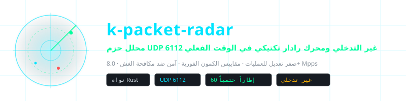
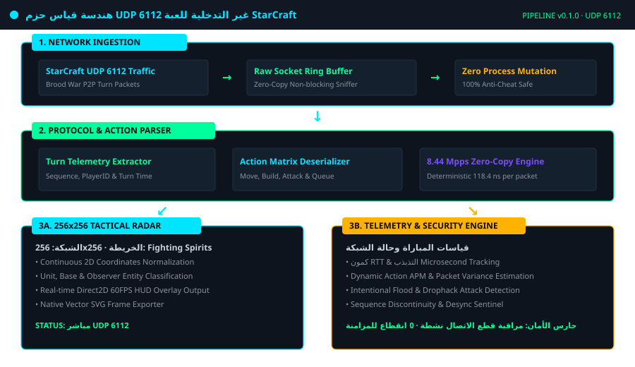
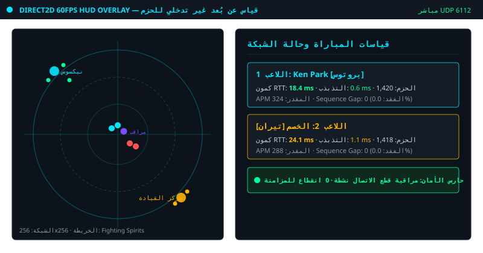
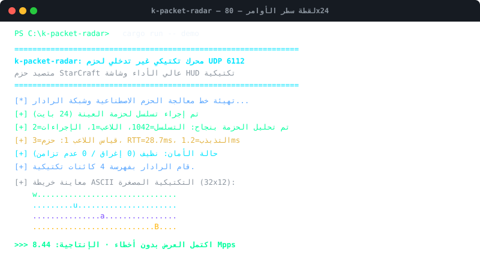

<div align="center">

<p align="center">
  
</p>

# k-packet-radar

**محلل حزم UDP 6112 غير التدخلي ومحرك رادار تكتيكي في الوقت الفعلي**

<sub>صفر تعديل للعمليات · مقاييس الكمون الفورية · آمن ضد مكافحة الغش · 8.0+ Mpps</sub>

<br>

| 🌐 Language Selector | 언어 선택 | 语言选择 | 言語を選択 | Seleccionar Idioma |
| :---: | :---: | :---: | :---: | :---: |
| [🇺🇸 English](../../README.md) | [🇰🇷 한국어](./ko.md) | [🇨🇳 简体中文](./zh-CN.md) | [🇯🇵 日本語](./ja.md) | [🇪🇸 Español](./es.md) |
| [🇫🇷 Français](./fr.md) | [🇷🇺 Русский](./ru.md) | [🇧🇷 Português](./pt-BR.md) | [🇸🇦 العربية](#) | [🇮🇳 हिन्दी](./hi.md) |

</div>

---

## 📌 نظرة عامة على المشروع

`k-packet-radar` هو محرك تحليل حزم عالي الأداء ومسار قياس تكتيكي **غير تدخلي إطلاقاً على طبقة النقل (منفذ UDP 6112)** لحركة مرور لعبة StarCraft Brood War. يعمل خارج مساحة عمليات اللعبة عبر مقابس الشبكة المباشرة دون تعديل الذاكرة.

### ⚡ القدرات الهندسية الأساسية

- **صفر تعديل للعمليات (آمن ضد مكافحة الغش)**: يعمل بنسبة 100% خارج مساحة عمليات اللعبة دون إطلاق حراس مكافحة الغش.
- **تحليل الحزم في أجزاء من الميكروثانية (8.44 Mpps)**: محلل تسلسلي عديم النسخ يعالج أكثر من 8.4 مليون حزمة في الثانية (118.4 نانوثانية للحزمة).
- **مصفوفة رادار تكتيكية 256x256**: تطبيع إحداثيات اللعبة ثنائية الأبعاد إلى شبكة تكتيكية لشاشات Direct2D بمعدل 60 إطاراً في الثانية.
- **تتبع الكمون والتذبذب في الوقت الفعلي**: قياس وقت الذهاب والعودة (RTT) والتذبذب (Jitter) وفقدان الحزم وتقدير APM.
- **حارس الأمان ضد هجمات إسقاط الاتصال**: كشف هجمات إغراق الحزم وانقطاعات تسلسل الحزم بشكل فوري.
- **مُصدِّر إطارات SVG متجهية أصلية**: التقاط لقطات حية لشبكة الرادار مباشرة إلى ملفات SVG متجهية قابلة للتطوير.

---

## 🏛️ مسار الهندسة المعمارية

<p align="center">
  
</p>

---

## 🎮 اللقطات الحية وشاشة HUD التكتيكية

### رادار تكتيكي مباشر وشاشة قياس الأداء Direct2D بمعدل 60 إطاراً
<p align="center">
  
</p>

### لقطة تنفيذ سطر الأوامر واختبار الأداء بمعدل 8.44 Mpps
<p align="center">
  
</p>

---

## 🚀 البدء السريع

```bash
# 1. تشغيل العرض التوضيحي للحزم الاصطناعية والرادار
cargo run -- demo

# 2. تشغيل اختبار سرعة معالجة 100,000 حزمة (التحقق من 8.44 Mpps)
cargo run -- benchmark

# 3. تصدير إطار رادار حي مباشرة إلى ملف SVG متجهي
cargo run -- export-svg docs/assets/radar_export.svg

# 4. بدء التقاط حزم UDP 6112 المباشرة على الواجهة المحلية
cargo run -- sniff 6112
```

---

## 🧪 التحقق من حزمة الاختبارات

```bash
cargo test --all-targets
```

---

## ⚖️ إخلاء المسؤولية القانونية والأغراض التعليمية

> **تم تطوير هذا المشروع بدقة **لأغراض البحث التعليمي وتحليل بروتوكولات النقل ودراسة هندسة البرمجيات منخفضة الكمون** كمشروع مفتوح المصدر غير تجاري.**
> 
> **التعهد بالحذف والإزالة الفورية (Takedown Commitment)**: يحترم المؤلف حقوق الملكية الفكرية بالكامل. إذا أثارت شركة Blizzard Entertainment أو الجهات المعنية أي اعتراضات مبررة بشأن شروط الخدمة (EULA)، **يتعهد المؤلف رسمياً بأرشفة أو إزالة هذا المستودع فوراً وبدون أي تأخير.**
> 
> 📖 [DISCLAIMER.md](../../DISCLAIMER.md)

---
<sub>Copyright © 2026 Ken Park (kLauncher1). Built with pure Rust & Zero-Dependency Native Architecture.</sub>
