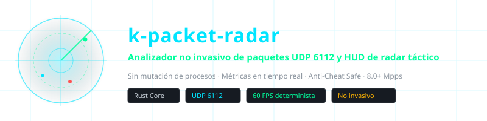
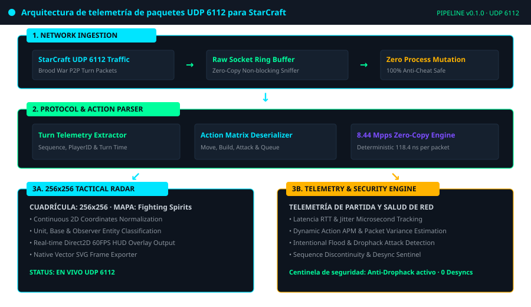
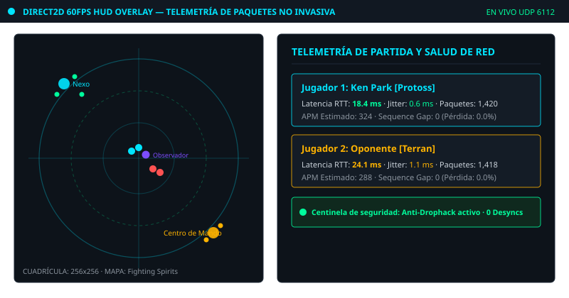
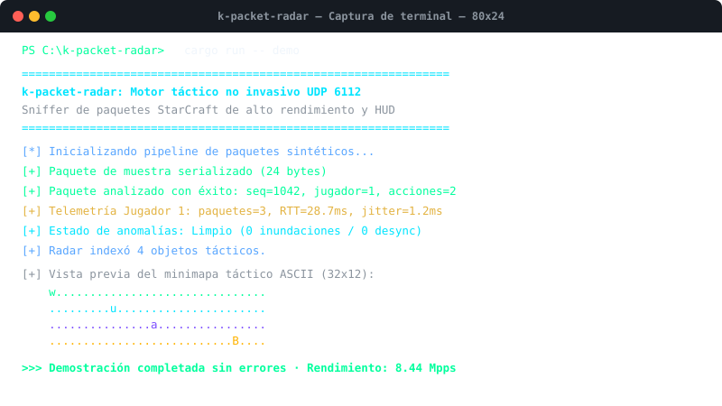

<div align="center">

<!-- 10-Language Navigation Bar -->
<p align="center">
  <a href="../../README.md">🇺🇸 English</a> · <a href="./ko.md">🇰🇷 한국어</a> · <a href="./zh-CN.md">🇨🇳 简体中文</a> · <a href="./ja.md">🇯🇵 日本語</a> · <b>🇪🇸 Español</b><br />
  <a href="./fr.md">🇫🇷 Français</a> · <a href="./ru.md">🇷🇺 Русский</a> · <a href="./pt-BR.md">🇧🇷 Português</a> · <a href="./ar.md">🇸🇦 العربية</a> · <a href="./hi.md">🇮🇳 हिन्दी</a>
</p>

<p align="center">
  
</p>

# k-packet-radar

**Analizador no invasivo de paquetes UDP 6112 y HUD de radar táctico**

<sub>Sin mutación de procesos · Métricas en tiempo real · Anti-Cheat Safe · 8.0+ Mpps</sub>

</div>

---

## 📌 Descripción General

`k-packet-radar` es un motor de análisis de paquetes de alto rendimiento y canal de telemetría táctica **completamente no invasivo en la capa de transporte (UDP puerto 6112)** diseñado para el tráfico de red de StarCraft Brood War. Funciona fuera de proceso mediante sockets raw sin inyectar DLLs ni modificar la memoria del juego.

### ⚡ Capacidades Técnicas Clave

- **Mutación Cero de Procesos (Anti-Cheat Safe)**: Funciona 100% fuera del proceso del juego sin activar guardianes antitrampas.
- **Análisis de Microsegundos (8.44 Mpps)**: Deserializador de paquetes zero-copy capaz de procesar más de 8 millones de paquetes por segundo (118.4 ns por paquete).
- **Matriz de Radar Táctico 256x256**: Normaliza coordenadas 2D en una cuadrícula táctica discreta para superposiciones Direct2D a 60 FPS.
- **Seguimiento de Latencia y Jitter**: Mide tiempo de ida y vuelta (RTT), fluctuación (jitter), pérdida de paquetes y APM estimado en tiempo real.
- **Centinela contra Drophack y Anomalías**: Detecta inundaciones de paquetes maliciosas y discontinuidades de secuencia.
- **Exportador Nativo de Cuadros SVG**: Captura estados del radar directamente en archivos vectoriales SVG escalables.

---

## 🏛️ Canal de Arquitectura

<p align="center">
  
</p>

---

## 🎮 Capturas en Vivo y HUD Táctico

### HUD de Radar Táctico y Telemetría en Juego Direct2D a 60 FPS
<p align="center">
  
</p>

### Ejecución en Terminal CLI y Benchmark a 8.44 Mpps
<p align="center">
  
</p>

---

## 🚀 Inicio Rápido

```bash
# 1. Ejecutar demostración de telemetría y radar sintético
cargo run -- demo

# 2. Ejecutar benchmark de rendimiento de 100,000 paquetes (8.44 Mpps)
cargo run -- benchmark

# 3. Exportar un fotograma del radar en vivo directamente a SVG vectorial
cargo run -- export-svg docs/assets/radar_export.svg

# 4. Iniciar captura UDP 6112 en la interfaz de red local
cargo run -- sniff 6112
```

---

## 🧪 Verificación del Banco de Pruebas

```bash
cargo test --all-targets
```

---

## ⚖️ Descargo de Responsabilidad Legal y Propósito Educativo

> **Este proyecto ha sido desarrollado estrictamente para **investigación educativa, análisis de protocolos de red y exploración de ingeniería de software de baja latencia** sin fines comerciales.**
> 
> **Compromiso de Retirada Inmediata (Takedown Commitment)**: El autor respeta todos los derechos de propiedad intelectual y normativas de servicio. Si Blizzard Entertainment o las partes pertinentes presentan alguna inquietud justificada respecto a los términos de servicio (EULA), **el autor se compromete solemnemente a archivar o eliminar este repositorio de inmediato sin demora alguna.**
> 
> 📖 [DISCLAIMER.md](../../DISCLAIMER.md)

---
<sub>Copyright © 2026 Ken Park (kLauncher1). Built with pure Rust & Zero-Dependency Native Architecture.</sub>
