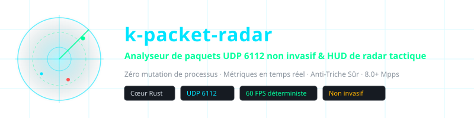
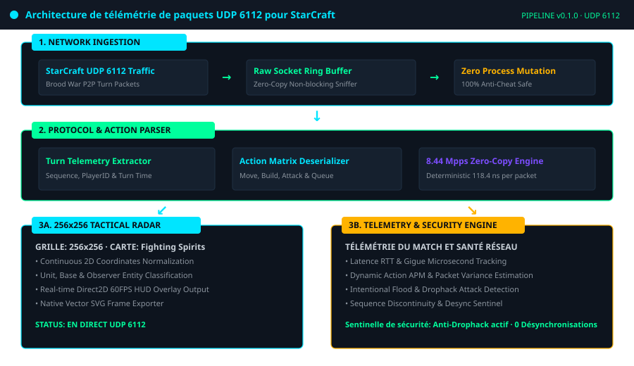
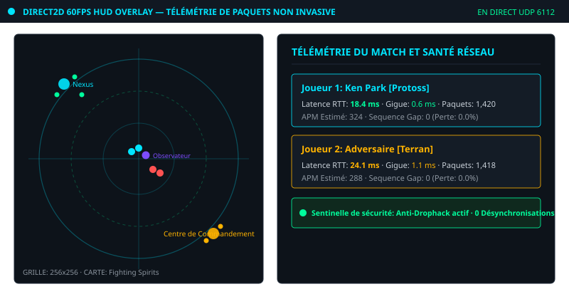
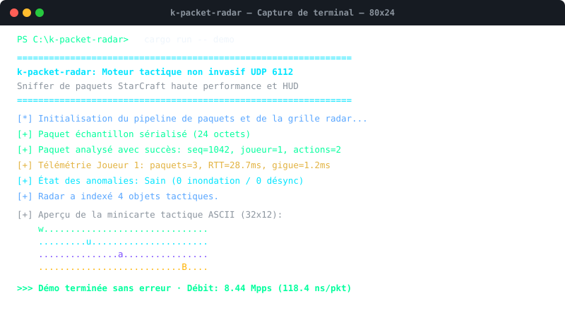

<div align="center">

<!-- 10-Language Navigation Bar -->
<p align="center">
  <a href="../../README.md">🇺🇸 English</a> · <a href="./ko.md">🇰🇷 한국어</a> · <a href="./zh-CN.md">🇨🇳 简体中文</a> · <a href="./ja.md">🇯🇵 日本語</a> · <a href="./es.md">🇪🇸 Español</a><br />
  <b>🇫🇷 Français</b> · <a href="./ru.md">🇷🇺 Русский</a> · <a href="./pt-BR.md">🇧🇷 Português</a> · <a href="./ar.md">🇸🇦 العربية</a> · <a href="./hi.md">🇮🇳 हिन्दी</a>
</p>

<p align="center">
  
</p>

# k-packet-radar

**Analyseur de paquets UDP 6112 non invasif & HUD de radar tactique**

<sub>Zéro mutation de processus · Métriques en temps réel · Anti-Triche Sûr · 8.0+ Mpps</sub>

</div>

---

## 📌 Aperçu du Projet

`k-packet-radar` est un moteur d’analyse de paquets haute performance et un pipeline de télémétrie tactique **strictement non invasif au niveau de la couche transport (port UDP 6112)** conçu pour StarCraft Brood War. Il fonctionne hors processus sans modifier la mémoire ni déclencher d’anti-triche.

### ⚡ Capacités Techniques Clés

- **Zéro Mutation de Processus (Anti-Triche Sûr)**: Fonctionne à 100% hors processus via des sockets réseau bruts.
- **Désérialisation Microseconde (8.44 Mpps)**: Analyseur sans copie traitant plus de 8,4 millions de paquets par seconde (118.4 ns par paquet).
- **Matrice Radar Tactique 256x256**: Normalise l’espace 2D en une grille discrète pour les overlays Direct2D à 60 FPS.
- **Mesure de Latence et de Gigue en Temps Réel**: Suivi du temps d’aller-retour (RTT), de la gigue (jitter), des pertes et de l’APM estimé.
- **Sentinelle contre le Drophack et les Anomalies**: Détection proactive des attaques par inondation de paquets et désynchronisation.
- **Exportateur Vectoriel SVG Natif**: Capture instantanée des grilles tactiques directement au format vectoriel SVG.

---

## 🏛️ Pipeline Architectural

<p align="center">
  
</p>

---

## 🎮 Captures Visuelles et HUD Tactique

### Radar Tactique en Jeu et Télémétrie Direct2D à 60 FPS
<p align="center">
  
</p>

### Capture d’Exécution Terminal et Benchmark à 8.44 Mpps
<p align="center">
  
</p>

---

## 🚀 Démarrage Rapide

```bash
# 1. Exécuter la démonstration de télémétrie radar synthétique
cargo run -- demo

# 2. Exécuter le benchmark de débit de 100 000 paquets (8.44 Mpps)
cargo run -- benchmark

# 3. Exporter une trame radar en direct vers un fichier SVG vectoriel
cargo run -- export-svg docs/assets/radar_export.svg

# 4. Démarrer la capture UDP 6112 sur l’interface locale
cargo run -- sniff 6112
```

---

## 🧪 Vérification de la Suite de Tests

```bash
cargo test --all-targets
```

---

## ⚖️ Avertissement Légal et Objectif Éducatif

> **Ce projet est conçu exclusivement à des **fins de recherche éducative, d’analyse de protocoles de transport réseau et d’étude en ingénierie logicielle à faible latence** à but non lucratif.**
> 
> **Engagement de Retrait Immédiat (Takedown Commitment)**: L’auteur respecte scrupuleusement la propriété intellectuelle. Si Blizzard Entertainment ou les autorités compétentes soulèvent une objection légitime concernant les conditions d’utilisation (EULA), **l’auteur s’engage solennellement à archiver ou supprimer ce dépôt immédiatement sans aucun délai.**
> 
> 📖 [DISCLAIMER.md](../../DISCLAIMER.md)

---
<sub>Copyright © 2026 Ken Park (kLauncher1). Built with pure Rust & Zero-Dependency Native Architecture.</sub>
