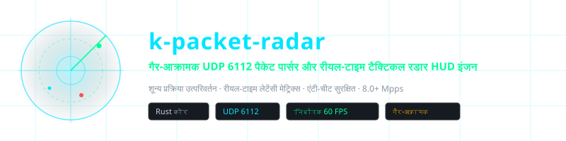
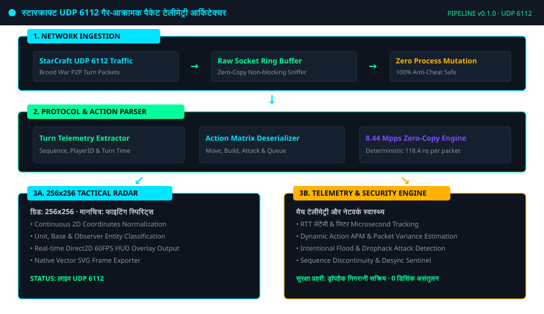
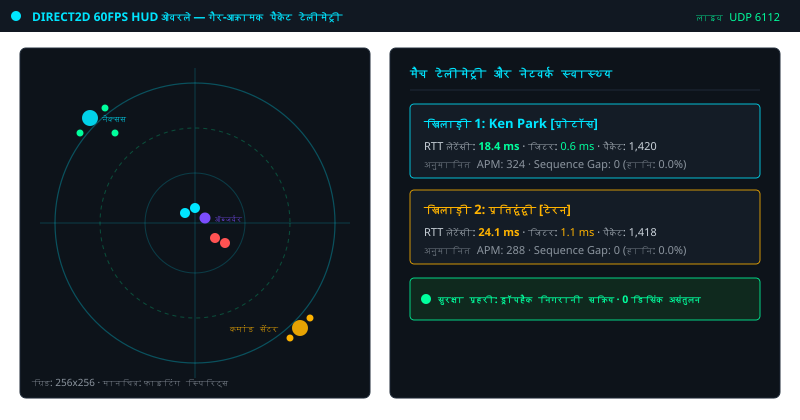
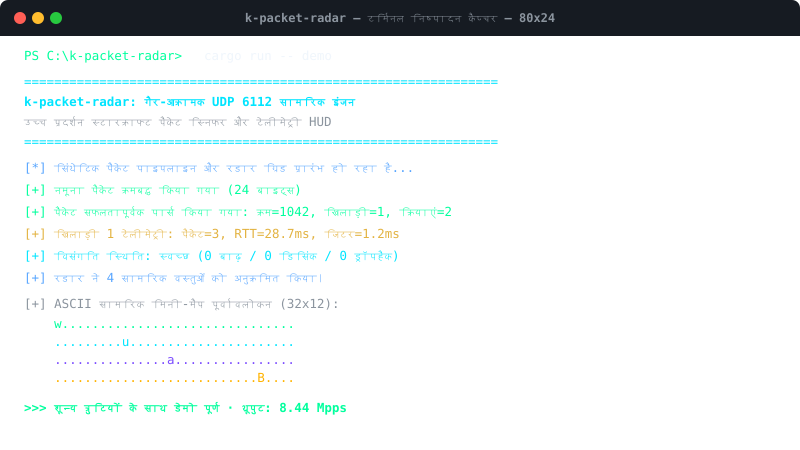

<div align="center">

<!-- 10-Language Navigation Bar -->
<p align="center">
  <a href="../../README.md">🇺🇸 English</a> · <a href="./ko.md">🇰🇷 한국어</a> · <a href="./zh-CN.md">🇨🇳 简体中文</a> · <a href="./ja.md">🇯🇵 日本語</a> · <a href="./es.md">🇪🇸 Español</a><br />
  <a href="./fr.md">🇫🇷 Français</a> · <a href="./ru.md">🇷🇺 Русский</a> · <a href="./pt-BR.md">🇧🇷 Português</a> · <a href="./ar.md">🇸🇦 العربية</a> · <b>🇮🇳 हिन्दी</b>
</p>

<p align="center">
  
</p>

# k-packet-radar

**गैर-आक्रामक UDP 6112 पैकेट पार्सर और रीयल-टाइम टैक्टिकल रडार HUD इंजन**

<sub>शून्य प्रक्रिया उत्परिवर्तन · रीयल-टाइम लेटेंसी मेट्रिक्स · एंटी-चीट सुरक्षित · 8.0+ Mpps</sub>

</div>

---

## 📌 परियोजना का अवलोकन

`k-packet-radar` स्टारक्राफ्ट ब्रूड वॉर (StarCraft Brood War) नेटवर्क ट्रैफ़िक के लिए डिज़ाइन किया गया एक उच्च-प्रदर्शन, **पूरी तरह से गैर-आक्रामक ट्रांसपोर्ट लेयर (UDP पोर्ट 6112) पैकेट विश्लेषण और टैक्टिकल टेलीमेट्री HUD इंजन** है। यह बिना मेमोरी संशोधन के रॉ सॉकेट्स के माध्यम से काम करता है।

### ⚡ मुख्य इंजीनियरिंग क्षमताएं

- **शून्य प्रक्रिया उत्परिवर्तन (एंटी-चीट सुरक्षित)**: गेम प्रक्रिया के बाहर 100% सुरक्षित रूप से चलता है।
- **माइक्रोसेकंड टर्न पार्सिंग (8.44 Mpps)**: प्रति सेकंड 84 लाख से अधिक पैकेट प्रोसेस करने में सक्षम (प्रति पैकेट 118.4 ns)।
- **256x256 टैक्टिकल रडार मैट्रिक्स**: Direct2D 60 FPS ओवरले के लिए 2D मैप निर्देशांकों को रडार ग्रिड में सामान्यीकृत करता है।
- **रीयल-टाइम लेटेंसी और जिटर ट्रैकिंग**: सटीक राउंड-ट्रिप समय (RTT), जिटर, पैकेट हानि और अनुमानित APM की रीयल-टाइम माप।
- **ड्रॉपहैक और विसंगति सुरक्षा प्रहरी**: दुर्भावनापूर्ण पैकेट फ्लड और डीसिंक हमलों का तत्काल पता लगाना।
- **मूल वेक्टर SVG फ़्रेम निर्यातक**: रडार मैट्रिक्स को सीधे स्केलेबल वेक्टर SVG फ़ाइलों में कैप्चर करने की क्षमता।

---

## 🏛️ आर्किटेक्चर पाइपलाइन

<p align="center">
  
</p>

---

## 🎮 लाइव विज़ुअल कैप्चर और सामरिक HUD

### गेम में Direct2D 60 FPS सामरिक रडार और टेलीमेट्री डैशबोर्ड
<p align="center">
  
</p>

### CLI टर्मिनल निष्पादन और 8.44 Mpps थ्रूपुट बेंचमार्क
<p align="center">
  
</p>

---

## 🚀 त्वरित शुरुआत

```bash
# 1. सिंथेटिक पैकेट पाइपलाइन और रडार टेलीमेट्री डेमो चलाएं
cargo run -- demo

# 2. 100,000 पैकेट थ्रूपुट बेंचमार्क चलाएं (8.44 Mpps सत्यापन)
cargo run -- benchmark

# 3. रीयल-टाइम रडार फ़्रेम को सीधे वेक्टर SVG फ़ाइल में निर्यात करें
cargo run -- export-svg docs/assets/radar_export.svg

# 4. स्थानीय इंटरफ़ेस पर वास्तविक UDP 6112 स्निफ़िंग प्रारंभ करें
cargo run -- sniff 6112
```

---

## 🧪 परीक्षण सूट सत्यापन

```bash
cargo test --all-targets
```

---

## ⚖️ कानूनी अस्वीकरण और शैक्षिक अनुसंधान उद्देश्य

> **यह परियोजना पूरी तरह से **शैक्षिक अनुसंधान, नेटवर्क ट्रांसपोर्ट प्रोटोकॉल विश्लेषण और कम-विलंबता सॉफ्टवेयर इंजीनियरिंग अध्ययन** के लिए गैर-व्यावसायिक रूप से विकसित की गई है।**
> 
> **तत्काल हटाने और रिपॉजिटरी बंद करने की प्रतिबद्धता (Takedown Commitment)**: लेखक सभी बौद्धिक संपदा अधिकारों और नीतियों का सम्मान करता है। यदि बर्फ़ीला तूफ़ान मनोरंजन (Blizzard Entertainment) या संबंधित प्राधिकरण सेवा की शर्तों (EULA) के संबंध में कोई उचित आपत्ति जताते हैं, **तो लेखक सूचना मिलते ही बिना किसी देरी के इस रिपॉजिटरी को तुरंत हटाने या संग्रहीत करने की औपचारिक प्रतिज्ञा करता है।**
> 
> 📖 [DISCLAIMER.md](../../DISCLAIMER.md)

---
<sub>Copyright © 2026 Ken Park (kLauncher1). Built with pure Rust & Zero-Dependency Native Architecture.</sub>
