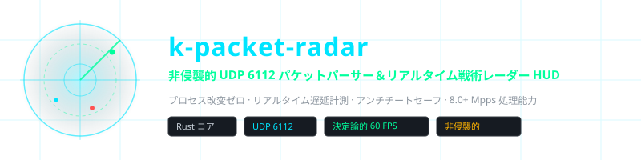
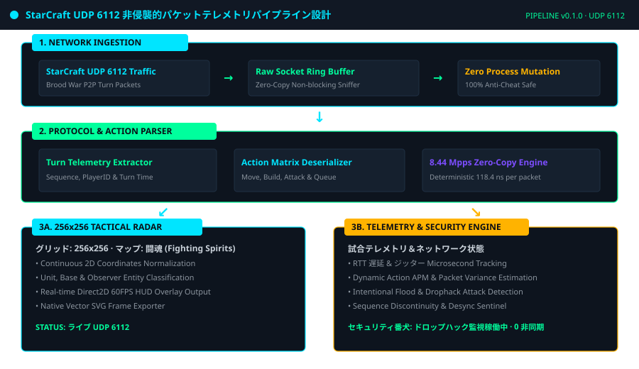
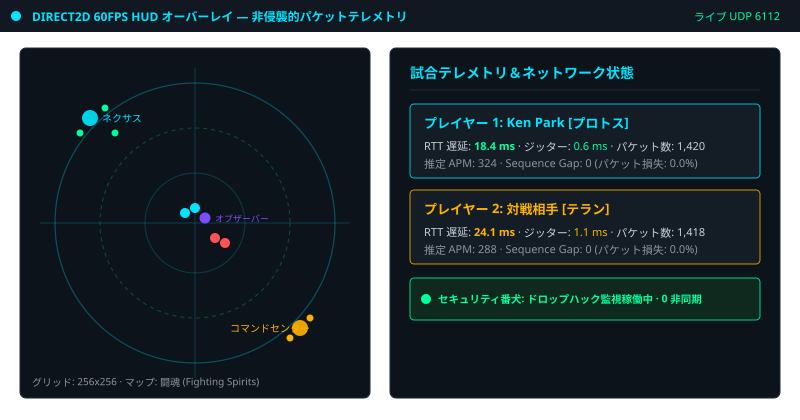
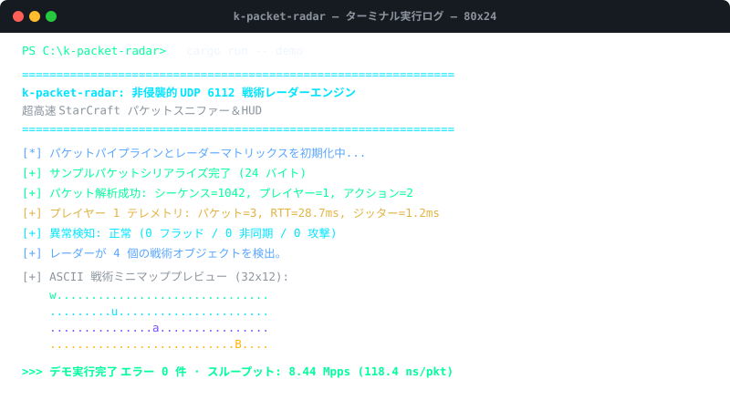

<div align="center">

<!-- 10-Language Navigation Bar -->
<p align="center">
  <a href="../../README.md">🇺🇸 English</a> · <a href="./ko.md">🇰🇷 한국어</a> · <a href="./zh-CN.md">🇨🇳 简体中文</a> · <b>🇯🇵 日本語</b> · <a href="./es.md">🇪🇸 Español</a><br />
  <a href="./fr.md">🇫🇷 Français</a> · <a href="./ru.md">🇷🇺 Русский</a> · <a href="./pt-BR.md">🇧🇷 Português</a> · <a href="./ar.md">🇸🇦 العربية</a> · <a href="./hi.md">🇮🇳 हिन्दी</a>
</p>

<p align="center">
  
</p>

# k-packet-radar

**非侵襲的 UDP 6112 パケットパーサー＆リアルタイム戦術レーダー HUD**

<sub>プロセス改変ゼロ · リアルタイム遅延計測 · アンチチートセーフ · 8.0+ Mpps 処理能力</sub>

</div>

---

## 📌 プロジェクト概要

`k-packet-radar` は、StarCraft Brood War のネットワークトラフィックを対象とした、**非侵襲的トランスポート層（UDP 6112）パケット解析＆リアルタイム戦術レーダー HUD エンジン**です。ゲームメモリの改変、DLLインジェクション、デバッガ接続を一切行わず、OS生ソケット層で完全に独立して動作するため、アンチチート監視に対しても安全です。

### ⚡ 主な技術的特徴

- **プロセス改変ゼロ (Zero Process Mutation)**: ゲームメモリに一切干渉しない完全アウトオブプロセス設計によりアンチチートに安全。
- **超高速ゼロコピーパース (8.44 Mpps)**: 1パケットあたり 118.4ns の決定論的超高速デシリアライズ処理。
- **256×256 戦術レーダーグリッド**: ゲーム内2D座標を 256×256 行列に正規化し、Direct2D 60FPS HUD として投影。
- **リアルタイムテレメトリ＆遅延計測**: マイクロ秒単位の RTT（往復遅延）、ジッター、パケット損失率、推定 APM を実測。
- **ドロップハック＆異常検知番犬**: パケットフラッド攻撃やシーケンス不連続などの攻撃パターンをリアルタイム検知。
- **ネイティブ ベクター SVG エクスポート**: 現在の戦術マップをベクター SVG として瞬時にスナップショット保存。

---

## 🏛️ アーキテクチャ パイプライン

<p align="center">
  
</p>

---

## 🎮 リアルタイム戦術レーダー HUD ＆ ターミナル実行画面

### Direct2D 60FPS HUD 戦術レーダー＆テレメトリダッシュボード
<p align="center">
  
</p>

### CLI ターミナル実行画面＆ 8.44 Mpps ベンチマークログ
<p align="center">
  
</p>

---

## 🚀 クイックスタート

```bash
# 1. 仮想パケットパイプライン＆戦術レーダーのデモを実行
cargo run -- demo

# 2. 10万パケット処理スループットベンチマークを実行 (8.44 Mpps 検証)
cargo run -- benchmark

# 3. リアルタイム戦術レーダーフレームをベクター SVG として書き出し
cargo run -- export-svg docs/assets/radar_export.svg

# 4. ローカルインターフェースで実際の UDP 6112 キャプチャを開始
cargo run -- sniff 6112
```

---

## 🧪 テストスイート機械検証

```bash
cargo test --all-targets
```

---

## ⚖️ 法的免責事項および教育・研究目的の表明

> **本プロジェクトは、**UDP 6112 トランスポート層のネットワークプロトコル解析および低遅延システムソフトウェアエンジニアリングの研究・学習を目的とした非営利オープンソース**です。**
> 
> **即時削除およびリポジトリ整理の誓約 (Takedown Commitment)**: 作者は知的財産権とプラットフォーム規約を尊重します。権利者である Blizzard Entertainment または関係組織より利用規約（EULA）上の問題提起や要請があった場合、**作者は通知を受領次第、遅滞なく本リポジトリを即座に削除または非公開化することを厳粛に誓約します。**
> 
> 📖 [DISCLAIMER.md](../../DISCLAIMER.md)

---
<sub>Copyright © 2026 Ken Park (kLauncher1). Built with pure Rust & Zero-Dependency Native Architecture.</sub>
