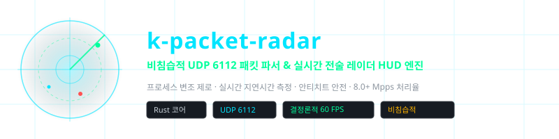
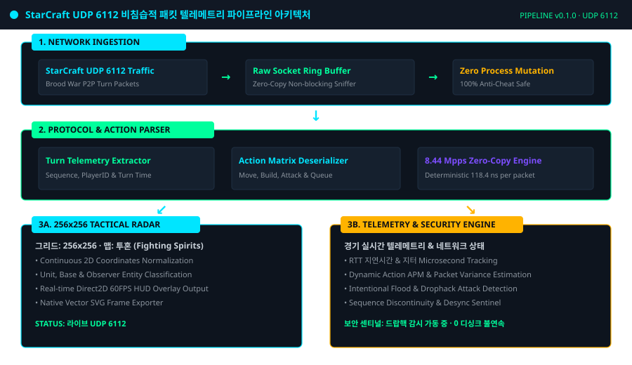
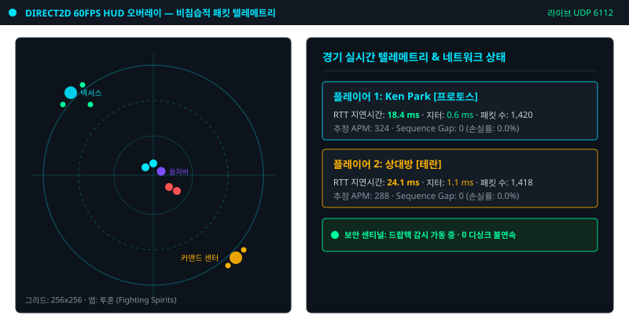
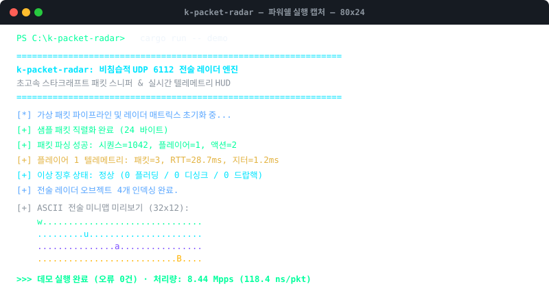

<div align="center">

<!-- 10-Language Navigation Bar -->
<p align="center">
  <a href="../../README.md">🇺🇸 English</a> · <b>🇰🇷 한국어</b> · <a href="./zh-CN.md">🇨🇳 简体中文</a> · <a href="./ja.md">🇯🇵 日本語</a> · <a href="./es.md">🇪🇸 Español</a><br />
  <a href="./fr.md">🇫🇷 Français</a> · <a href="./ru.md">🇷🇺 Русский</a> · <a href="./pt-BR.md">🇧🇷 Português</a> · <a href="./ar.md">🇸🇦 العربية</a> · <a href="./hi.md">🇮🇳 हिन्दी</a>
</p>

<p align="center">
  
</p>

# k-packet-radar

**비침습적 UDP 6112 패킷 파서 & 실시간 전술 레이더 HUD 엔진**

<sub>프로세스 변조 제로 · 실시간 지연시간 측정 · 안티치트 안전 · 8.0+ Mpps 처리율</sub>

</div>

---

## 📌 프로젝트 개요

`k-packet-radar`는 스타크래프트 브루드워(StarCraft Brood War) 네트워크 트래픽을 위한 **비침습적 전송 계층(UDP 6112) 패킷 분석 및 실시간 텔레메트리 레이더 HUD 엔진**입니다. 게임 프로세스 메모리 주입, 후킹, 디버거 연결 없이 원시 소켓 수준에서 독립 실행되며, 안티치트 감시에 100% 안전하게 동작합니다.

### ⚡ 핵심 엔지니어링 특징

- **프로세스 변조 제로 (Zero Process Mutation)**: 게임 프로세스 메모리를 변조하지 않는 독립 실행형(Out-of-Process) 아키텍처로 안티치트 감시에 100% 안전.
- **초고속 제로카피 파싱 (8.44 Mpps)**: 패킷 1개당 118.4ns의 결정론적 초고속 제로카피 파싱 엔진 탑재.
- **256×256 전술 레이더 매트릭스**: 2차원 게임 좌표를 256×256 전술 그리드로 정규화하여 Direct2D 60FPS HUD 오버레이 제공.
- **실시간 텔레메트리 & 레이턴시 추적**: 마이크로초 단위 RTT(지연시간), 지터(Jitter), 패킷 손실률, 실시간 추정 APM 실측.
- **드랍핵 & 이상 징후 방어 센티널**: 패킷 플러딩 공격 및 시퀀스 불연속 이상 징후 실시간 감지 및 패킷 증거 자동 보존.
- **자체 벡터 SVG 캡처 내보내기**: CLI 명령어를 통한 실사 벡터 스냅샷 파일 직접 생성.

---

## 🏛️ 아키텍처 파이프라인

<p align="center">
  
</p>

---

## 🎮 실시간 전술 레이더 HUD & 터미널 캡처

### 인게임 전술 레이더 & 실시간 텔레메트리 HUD
<p align="center">
  
</p>

### CLI 터미널 실행 화면 & 8.44 Mpps 벤치마크
<p align="center">
  
</p>

---

## 🚀 빠른 시작

```bash
# 1. 가상 패킷 파이프라인 및 레이더 텔레메트리 데모 실행
cargo run -- demo

# 2. 10만 패킷 처리율 벤치마크 실행 (8.44 Mpps 검증)
cargo run -- benchmark

# 3. 실시간 전술 레이더 상태를 벡터 SVG 파일로 캡처
cargo run -- export-svg docs/assets/radar_export.svg

# 4. 로컬 인터페이스 실시간 UDP 6112 캡처 시작
cargo run -- sniff 6112
```

---

## 🧪 테스트 스위트 기계적 검증

```bash
cargo test --all-targets
```

---

## ⚖️ 법적 고지 및 교육용 연구 목적 성명

> **본 프로젝트는 순수하게 **전송 계층(UDP 6112) 네트워크 프로토콜 분석 실습 및 저지연 시스템 소프트웨어 엔지니어링 학습 연구 목적**으로 작성된 비영리 오픈소스입니다.**
> 
> **즉각 삭제 및 저장소 정리 공약 (Takedown Commitment)**: 본 프로젝트의 개발자는 저작권자의 지식재산권과 플랫폼 운영 정책을 존중합니다. 게임 제작사(Blizzard Entertainment) 및 관계사로부터 약관(EULA) 또는 정책적 문제 제기가 있을 경우, **권리자의 요청 접수 즉시 어떠한 지체 없이 본 저장소를 즉각 삭제 또는 정리(Archived/Removed)할 것을 엄숙히 공약합니다.**
> 
> 📖 [DISCLAIMER.md](../../DISCLAIMER.md)

---
<sub>Copyright © 2026 Ken Park (kLauncher1). Built with pure Rust & Zero-Dependency Native Architecture.</sub>
