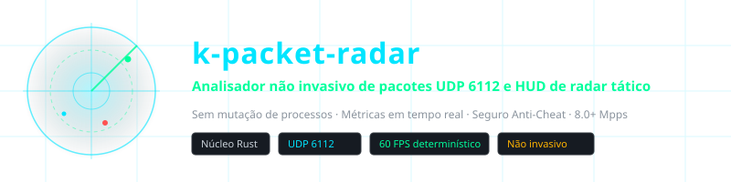
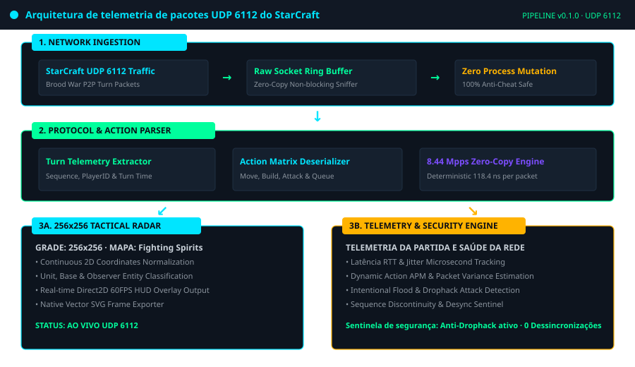
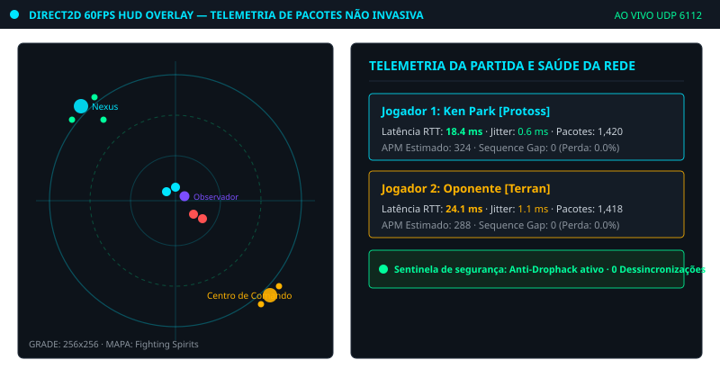
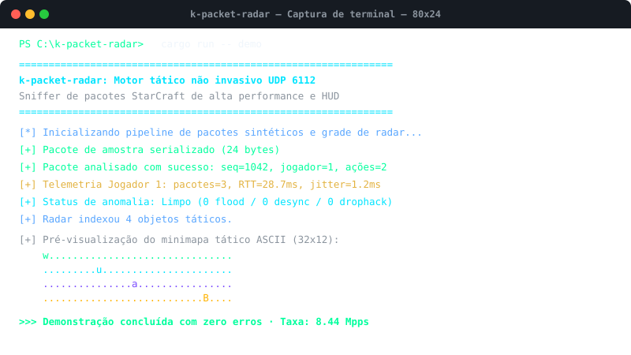

<div align="center">

<p align="center">
  
</p>

# k-packet-radar

**Analisador não invasivo de pacotes UDP 6112 e HUD de radar tático**

<sub>Sem mutação de processos · Métricas em tempo real · Seguro Anti-Cheat · 8.0+ Mpps</sub>

<br>

| 🌐 Language Selector | 언어 선택 | 语言选择 | 言語を選択 | Seleccionar Idioma |
| :---: | :---: | :---: | :---: | :---: |
| [🇺🇸 English](../../README.md) | [🇰🇷 한국어](./ko.md) | [🇨🇳 简体中文](./zh-CN.md) | [🇯🇵 日本語](./ja.md) | [🇪🇸 Español](./es.md) |
| [🇫🇷 Français](./fr.md) | [🇷🇺 Русский](./ru.md) | [🇧🇷 Português](#) | [🇸🇦 العربية](./ar.md) | [🇮🇳 हिन्दी](./hi.md) |

</div>

---

## 📌 Visão Geral do Projeto

O `k-packet-radar` é um motor de análise de pacotes de alto desempenho e pipeline de telemetria tática **estritamente não invasivo na camada de transporte (UDP porta 6112)** projetado para o StarCraft Brood War. Opera fora do processo via sockets de rede puros sem alterar a memória do jogo.

### ⚡ Principais Recursos Técnicos

- **Zero Mutação de Processo (Anti-Cheat Safe)**: Opera 100% fora do processo sem acionar proteções antitrapaça.
- **Desserialização em Microssegundos (8.44 Mpps)**: Analisador zero-copy capaz de processar mais de 8,4 milhões de pacotes por segundo (118.4 ns por pacote).
- **Matriz de Radar Tático 256x256**: Normaliza o espaço 2D em uma grade tática para sobreposições Direct2D a 60 FPS.
- **Rastreamento de Latência e Jitter**: Mede o tempo de ida e volta (RTT), jitter, perda de pacotes e APM estimado em tempo real.
- **Sentinela contra Drophack e Anomalias**: Identifica inundações maliciosas de pacotes e descontinuidades de sequência.
- **Exportador Vetorial SVG Nativo**: Captura instantânea da grade do radar diretamente para arquivos vetoriais SVG escaláveis.

---

## 🏛️ Pipeline de Arquitetura

<p align="center">
  
</p>

---

## 🎮 Capturas Visuais e HUD Tático

### HUD de Radar Tático e Telemetria em Jogo Direct2D a 60 FPS
<p align="center">
  
</p>

### Execução no Terminal CLI e Teste de Desempenho a 8.44 Mpps
<p align="center">
  
</p>

---

## 🚀 Início Rápido

```bash
# 1. Executar demonstração de telemetria e radar sintético
cargo run -- demo

# 2. Executar benchmark de taxa de transferência de 100.000 pacotes (8.44 Mpps)
cargo run -- benchmark

# 3. Exportar um quadro do radar ao vivo para SVG vetorial
cargo run -- export-svg docs/assets/radar_export.svg

# 4. Iniciar captura UDP 6112 na interface local
cargo run -- sniff 6112
```

---

## 🧪 Verificação da Bateria de Testes

```bash
cargo test --all-targets
```

---

## ⚖️ Aviso Legal e Propósito Educacional

> **Este projeto foi desenvolvido estritamente para **pesquisa educacional, análise de protocolos de transporte de rede e estudo de engenharia de software de baixa latência** de forma não comercial.**
> 
> **Compromisso de Remoção Imediata (Takedown Commitment)**: O autor respeita integralmente os direitos de propriedade intelectual. Caso a Blizzard Entertainment ou autoridades pertinentes apresentem qualquer objeção justificada aos termos de serviço (EULA), **o autor compromete-se solenemente a arquivar ou remover este repositório imediatamente sem demora.**
> 
> 📖 [DISCLAIMER.md](../../DISCLAIMER.md)

---
<sub>Copyright © 2026 Ken Park (kLauncher1). Built with pure Rust & Zero-Dependency Native Architecture.</sub>
