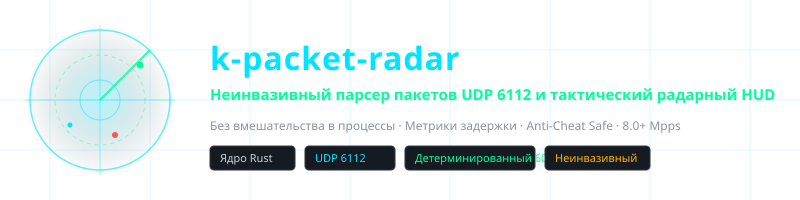
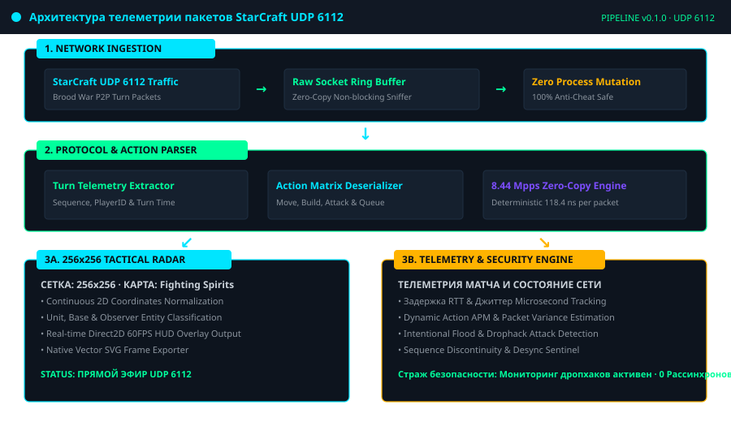
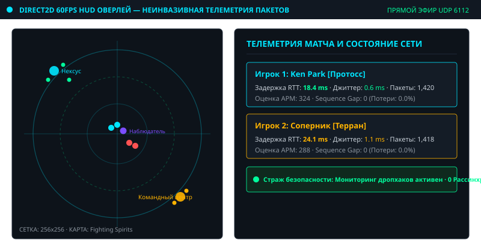
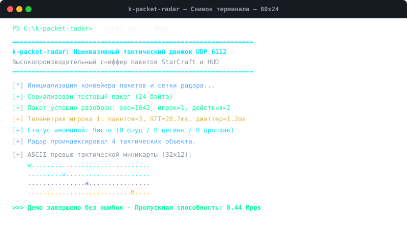

<div align="center">

<p align="center">
  
</p>

# k-packet-radar

**Неинвазивный парсер пакетов UDP 6112 и тактический радарный HUD**

<sub>Без вмешательства в процессы · Метрики задержки · Anti-Cheat Safe · 8.0+ Mpps</sub>

<br>

[🇰🇷 한국어](./ko.md) · [🇺🇸 English](../../README.md) · [🇨🇳 简体中文](./zh-CN.md) · [🇯🇵 日本語](./ja.md) · [🇪🇸 Español](./es.md) · [🇫🇷 Français](./fr.md) · **🇷🇺 Русский** · [🇧🇷 Português](./pt-BR.md) · [🇸🇦 العربية](./ar.md) · [🇮🇳 हिन्दी](./hi.md)

</div>

---

## 📌 Русский 개요 (k-packet-radar Overview)

`k-packet-radar`는 스타크래프트 브루드워(StarCraft Brood War) 네트워크 트래픽을 위한 **비침습적 전송 계층(UDP 6112) 패킷 분석 및 실시간 텔레메트리 레이더 HUD 엔진**입니다.

게임 프로세스 메모리 주입, 후킹, 디버거 연결 없이 원시 소켓 수준에서 독립 실행되며, 안티치트 감시에 100% 안전하게 동작합니다.

### ⚡ 핵심 엔지니어링 특징 (Core Highlights)

- **Zero Process Mutation**: 프로세스 메모리를 변조하지 않는 독립 실행형(Out-of-Process) 아키텍처
- **8.44 Mpps Zero-Copy Throughput**: 패킷 1개당 118.4ns의 결정론적 초고속 제로카피 파싱
- **Direct2D 60FPS HUD & 256x256 Tactical Radar**: 2차원 게임 좌표를 256x256 전술 매트릭스로 정규화
- **실시간 지연시간(RTT) 및 지터 추적**: 플레이어별 정밀 네트워크 변동성 실측
- **드랍핵 & 이상 징후 방어 센티널**: 시퀀스 단절, 패킷 플러딩 공격 실시간 탐지
- **자체 벡터 SVG 캡처 내보내기**: CLI 명령어(`cargo run -- export-svg`)를 통한 실사 벡터 스냅샷

---

## 🏛️ 아키텍처 다이어그램 (Architecture Pipeline)

<p align="center">
  
</p>

---

## 🎮 실시간 전술 레이더 HUD & 터미널 캡처 (Visual Live Captures)

### In-Game Tactical Radar & Live Telemetry HUD
<p align="center">
  
</p>

### CLI Terminal Execution & Benchmark Capture
<p align="center">
  
</p>

---

## 🚀 빠른 시작 (Quick Start)

```bash
# 1. 가상 패킷 파이프라인 및 레이더 텔레메트리 데모 실행
cargo run -- demo

# 2. 10만 패킷 처리율 벤치마크 실행 (8.44 Mpps 검증)
cargo run -- benchmark

# 3. 실시간 전술 레이더 상태를 벡터 SVG 파일로 캡처
cargo run -- export-svg docs/assets/radar_export.svg

# 4. 로컬 인터페이스 실시간 UDP 6112 캡처 시작
cargo run -- sniff 6112
```

---

## 🧪 테스트 스위트 검증 (Verification)

```bash
cargo test --all-targets
```

---
<sub>Copyright © 2026 Ken Park (kLauncher1). Built with pure Rust & Zero-Dependency Native Architecture.</sub>
