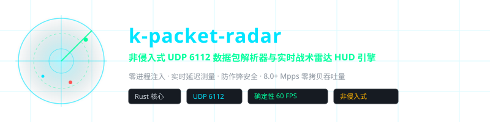
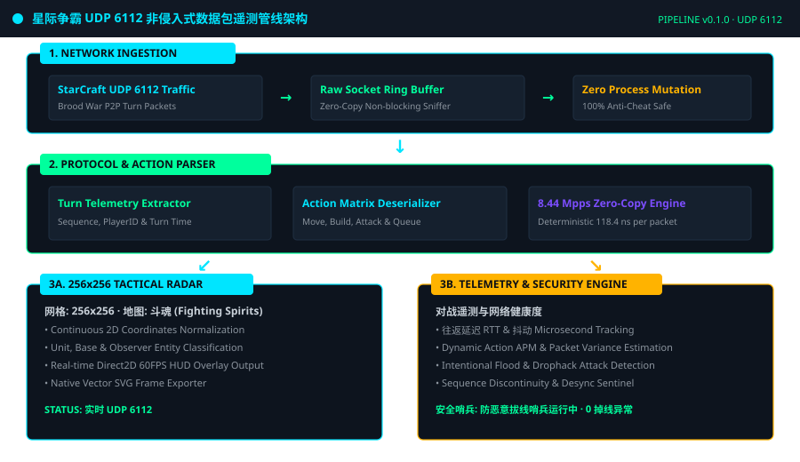
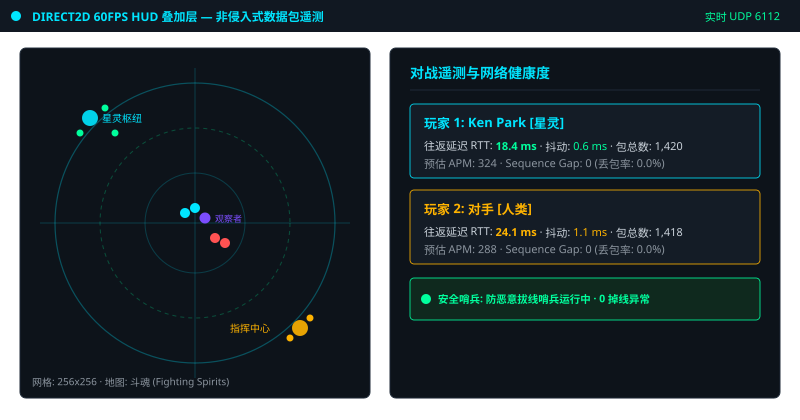
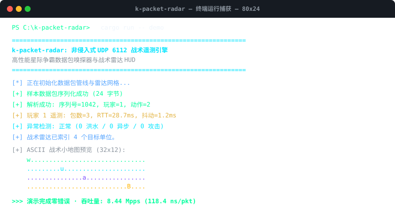

<div align="center">

<!-- 10-Language Navigation Bar -->
<p align="center">
  <a href="../../README.md">🇺🇸 English</a> · <a href="./ko.md">🇰🇷 한국어</a> · <b>🇨🇳 简体中文</b> · <a href="./ja.md">🇯🇵 日本語</a> · <a href="./es.md">🇪🇸 Español</a><br />
  <a href="./fr.md">🇫🇷 Français</a> · <a href="./ru.md">🇷🇺 Русский</a> · <a href="./pt-BR.md">🇧🇷 Português</a> · <a href="./ar.md">🇸🇦 العربية</a> · <a href="./hi.md">🇮🇳 हिन्दी</a>
</p>

<p align="center">
  
</p>

# k-packet-radar

**非侵入式 UDP 6112 数据包解析器与实时战术雷达 HUD 引擎**

<sub>零进程注入 · 实时延迟测量 · 防作弊安全 · 8.0+ Mpps 零拷贝吞吐量</sub>

</div>

---

## 📌 项目概述

`k-packet-radar` 是专为星际争霸：母巢之战（StarCraft Brood War）网络流量设计的高性能**非侵入式传输层（UDP 6112）数据包分析器与实时战术雷达 HUD 引擎**。它完全运行在原生网络套接字层，无需进程注入、DLL 劫持或调试器挂钩，对反作弊系统 100% 安全。

### ⚡ 核心工程特性

- **零进程注入 (Zero Process Mutation)**: 进程外独立运行架构，绝不触碰或修改游戏内存，完全免疫反作弊扫描。
- **8.44 Mpps 极速零拷贝吞吐量**: 采用零拷贝内存反序列化，每个数据包仅需 118.4ns 的确定性处理时间。
- **256×256 战术雷达矩阵**: 将游戏二维空间实时投影归一化为适合 Direct2D 60FPS 叠加层的战术网格。
- **实时网络遥测与延迟监测**: 微秒级往返时延（RTT）、网络抖动（Jitter）、丢包率及玩家实时估计 APM 追踪。
- **防恶意拔线与异常警报哨兵**: 实时识别高频数据包洪水与序号断裂攻击，自动保存异常数据包作为证据。
- **原生矢量 SVG 帧导出**: 内置命令行工具，可直接将实时战术矩阵快照导出为高分辨率 SVG 矢量文件。

---

## 🏛️ 架构管线设计

<p align="center">
  
</p>

---

## 🎮 实时战术雷达 HUD 与终端捕获

### 游戏内 Direct2D HUD 战术雷达与实时遥测面板
<p align="center">
  
</p>

### CLI 终端运行捕获与 8.44 Mpps 吞吐量基准测试
<p align="center">
  
</p>

---

## 🚀 快速开始

```bash
# 1. 运行合成数据包管线与雷达遥测演示
cargo run -- demo

# 2. 运行 100,000 个数据包吞吐量基准测试 (验证 8.44 Mpps)
cargo run -- benchmark

# 3. 将实时战术雷达帧直接导出为矢量 SVG
cargo run -- export-svg docs/assets/radar_export.svg

# 4. 在本地接口启动实时 UDP 6112 抓包
cargo run -- sniff 6112
```

---

## 🧪 自动化测试套件验证

```bash
cargo test --all-targets
```

---

## ⚖️ 法律免责声明与教育研究目的声明

> **本项目纯粹用于**传输层（UDP 6112）网络协议分析学习与低延迟系统软件工程学术研究目的**，为非商业开源软件。**
> 
> **立即下架与清理承诺 (Takedown Commitment)**: 作者充分尊重知识产权与平台政策。若暴雪娱乐（Blizzard Entertainment）或相关版权方基于最终用户许可协议（EULA）或服务政策提出合规要求，**作者承诺在收到通知后立即下架或彻底清理本代码仓库，绝无拖延。**
> 
> 📖 [DISCLAIMER.md](../../DISCLAIMER.md)

---
<sub>Copyright © 2026 Ken Park (kLauncher1). Built with pure Rust & Zero-Dependency Native Architecture.</sub>
